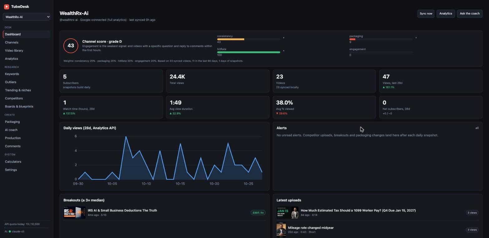
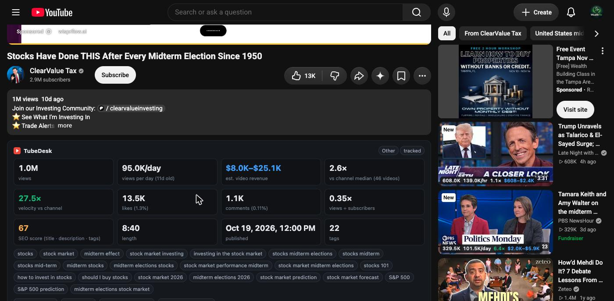
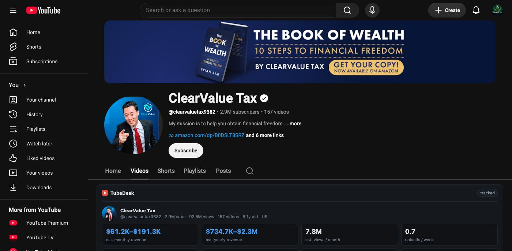
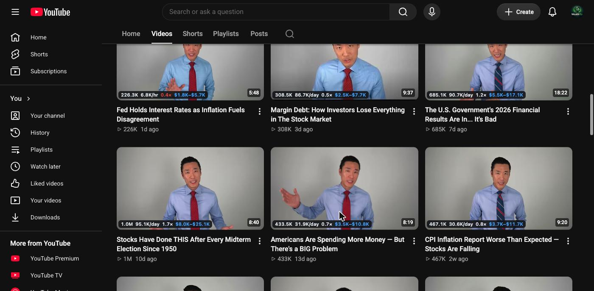
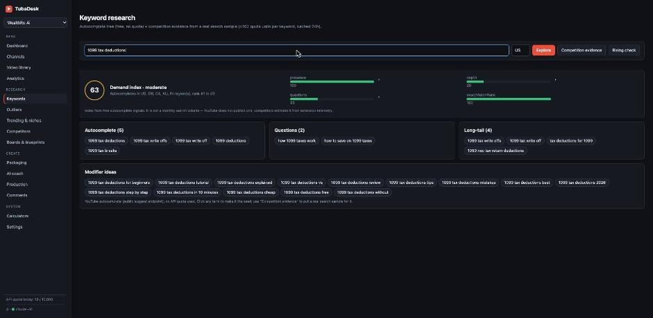
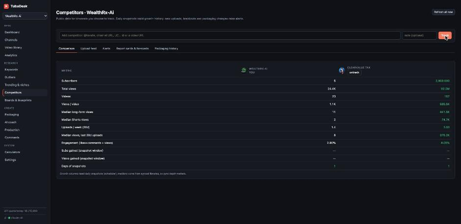
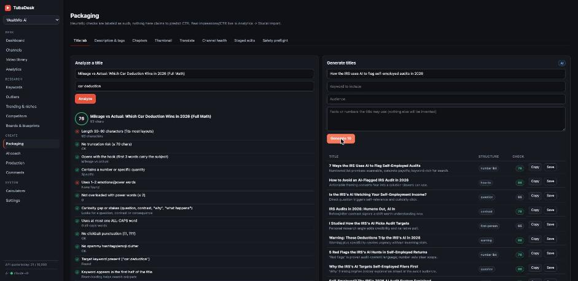

# TubeDesk

A self-hosted YouTube channel desk for the channels you own: analytics, keyword research, outliers, competitor tracking, packaging tools, an AI coach, production helpers and a comment inbox. It runs on your own machine against Google's free APIs and your existing Claude Code install, so there is nothing to subscribe to.

<p align="center">
  
  
</p>
<p align="center">
  
  
</p>
<p align="center">
  
  
  
</p>

## What it does

| Area | Features | Data source |
|---|---|---|
| **Channels** | Multi-channel workspaces with isolated data; connect with Google (ownership proof) or add by ID/handle/URL; bulk switching | Data API, OAuth |
| **Video library** | Filter by format/date/text, sort, per-video detail, publishing checklist, first-N-days vs peer comparison, daily view history, packaging-change history, staged metadata edits applied via `videos.update`, CSV export, JSON backup, playlists | Data API |
| **Analytics** (owner) | Overview with period deltas, daily charts, top videos, audience retention curve with drop detection, traffic sources incl. **real search terms**, suggested-from videos, external sites, geography, age/gender, devices, subscribers gained/lost by day and by video, watch hours + YPP progress, content-type mix, revenue/RPM (YPP channels), publish-slot heatmap, **impressions & CTR via Studio CSV import** | Analytics API, local data, Studio export |
| **Keywords** | Autocomplete tree (letters + question prefixes), long-tail and question lists, modifiers, competition evidence from a real search sample with a transparent opportunity score, score history, rising/dropped suggestions | Suggest endpoint (free), Data API |
| **Outliers** | Library outliers across own + competitor channels (views ÷ channel median, per format), search-driven breakout finder (views ÷ subscribers, velocity), similar videos | Local data, Data API |
| **Trending & niches** | mostPopular chart by region/category, niche channel finder sized by views-per-video, title structure analysis (patterns, never copied titles) | Data API |
| **Competitors** | Watchlist, side-by-side comparison, upload feed, daily snapshots → growth, alerts (new uploads, 3× breakouts, title/thumbnail changes), report cards, 90-day scenario projections, packaging history | Data API + scheduler |
| **Packaging** | Title analyzer (named heuristics, no CTR claims), AI title generator, description checker/drafter, tag helper (500-char limit enforced), chapter validator, thumbnail preview in YouTube layouts incl. 160px test, AI thumbnail critique, Test & Compare planner, metadata translation, channel health report, staged-edit review, safety preflight | Local + AI |
| **AI coach** | Quick / deep / max modes grounded in a factual context built from your data, daily ideas, idea generator, channel audit, weekly plan, idea validation, beginner next steps, lessons | Claude Code CLI |
| **Production** | Script writer with [CITE] markers, caption download for owned videos, chapters from transcript, clip-moment finder for Shorts, repurposing (blog/LinkedIn/Threads/newsletter), hook advisor, script rubric | Data API + AI |
| **Comments** | Inbox with unanswered/question/mention filters, question clusters, word cloud, AI reply drafts, reply templates, post replies, transparent giveaway draw, CSV | Data API |
| **Scores** | Channel Score (consistency, packaging health, hit rate, engagement, growth) with the weakest signal called out; per-video Score (packaging × performance vs channel median × engagement); keyword Demand Index — all with components and formulas visible | Local data, suggest |
| **Browser extension** | On youtube.com: stats panel under every video (views, views/hour or /day, **estimated video revenue**, outlier × vs that channel's median, velocity, likes/comments rates, views ÷ subs, SEO score, length, publish time, tags + copy), a channel card with **estimated monthly/yearly revenue**, uploads/week, median views and recent breakouts; a full channel panel on any channel page with its recent uploads ranked by outlier ×; **chips on every thumbnail** across home, search, related and channel grids (views, views/day, × vs channel average, est. revenue); one-click track-as-competitor and save-to-board; demand panel on search results; popup with your channels' today numbers and alerts | Local TubeDesk server |
| **System** | Quota meter and history, response cache, daily scheduler, earnings and valuation scenario calculators | — |

Everything that is an estimate or heuristic is labeled as such in the UI. Nothing asserts proprietary scores, predicted CTR, or third-party revenue figures.

## Requirements

- Node.js 20+
- ffmpeg (optional, for the media pipeline) and cloudflared (optional, for Instagram publishing) — both free via Homebrew (Claude Code already needs this)
- A Google Cloud project (free) with **YouTube Data API v3** and **YouTube Analytics API** enabled
- Claude Code on PATH for the AI features (`claude --version` works), or an Anthropic API key

## Install

```bash
cd tubedesk
npm install
npm start            # http://localhost:4949
```

`npm test` runs 28 backend tests against a built-in mock of the YouTube APIs. `python3 test/ui-smoke.py` drives every screen in headless Chromium and `xvfb-run python3 test/ext-smoke.py` loads the extension against fake YouTube pages (both need `pip install playwright && playwright install chromium`).

### Run it permanently on a Mac (launchd)

```bash
./install-mac.sh     # installs a LaunchAgent that starts TubeDesk at login and keeps it running
```

Logs: `~/Library/Logs/tubedesk.log`. Remove with `launchctl unload ~/Library/LaunchAgents/com.tubedesk.plist`.

## Setup (once, ~10 minutes)

1. Create a Google Cloud project → **APIs & Services → Library** → enable *YouTube Data API v3* and *YouTube Analytics API*.
2. **Credentials → Create credentials → API key.** Paste it into Settings. This alone powers all public data (10,000 units/day; the app caches aggressively and shows the meter).
3. **Credentials → Create credentials → OAuth client ID → Web application.** Add redirect URI `http://localhost:4949/oauth/callback`. On the OAuth consent screen choose External and add your Google account(s) as test users. Paste client ID and secret into Settings.
4. Channels → **Connect with Google.** Every channel the account owns (including brand channels) is added, tokens are stored locally, and the library syncs.
5. Add competitors under Competitors. The daily snapshot (06:15 local by default) refreshes everything and raises alerts.

### Browser extension

`chrome://extensions` → Developer mode → **Load unpacked** → choose the `extension/` folder. Works in Chrome, Brave, Edge, Arc (Firefox: load `manifest.json` as a temporary add-on). It only talks to `http://localhost:4949`; change the address under the extension's options if you run TubeDesk elsewhere.

**About the revenue numbers.** For channels you don't own, YouTube publishes no revenue, so the extension estimates it the way vidIQ and Social Blade do: public views × an RPM band for the niche (detected from title/tags/category; Shorts get the Shorts band). It's a range, not a measurement. Your own channels' real revenue is under Analytics → Revenue once connected with Google. Thumbnail chips cost 1 quota unit per 50 videos (+1 per 50 channels) and are cached, so an hour of browsing is a few dozen units out of 10,000.

**Updating.** Pull or copy the new files, then Settings → **Restart TubeDesk** (the LaunchAgent relaunches it) and click the reload icon on the extension's card in `chrome://extensions`.

### Audit export

`GET /api/export/audit/<channelId>` writes `data/exports/<handle>-tubedesk-audit.json`: channel identity, the full synced catalogue (id, title, URL, date, duration, format, description, tags), channel and per-video Analytics for the latest 28 complete days and the 28 before (views, watch time, avg view duration, avg % viewed, likes, comments, shares, subs gained, advertising views), traffic sources, retention curves (capped at 60 videos; `?retention=N`), revenue, and Studio-import impressions/CTR when present. Every dataset carries its source and dates; anything unavailable is `null` with a reason. No credentials are included. `?days=7` changes the window.

### Impressions and CTR

No Google API exposes impressions or click-through rate. YouTube Studio → Analytics → Advanced mode → Content → add the Impressions / CTR / Average view duration columns → Export → CSV, then drop the file on Analytics → *Impressions & CTR*.

## Publishing (YouTube + Instagram) — built for AI agents

TubeDesk can post for you, so any model that can call HTTP or run a command on your machine (Claude Code, Cursor, Codex, ChatGPT, Gemini, Grok, a cron script) can publish without browser automation:

- **YouTube** uses the channel's existing Google authorization (no extra setup): resumable upload, scheduling (`publishAt`), custom thumbnail, playlist, AI-content disclosure. Cost: 1,600 API units per upload (≈6/day on the free quota).
- **Instagram** Reels and images through the Instagram API: Settings → Instagram (professional account + a free Meta app token, ~5 minutes). Instagram downloads the file from a public URL, so TubeDesk serves it through your `public_base_url` or opens a free `cloudflared` quick tunnel only while the job runs (`brew install cloudflared`). Only that one unguessable media URL is reachable from outside; every other route refuses proxied requests.

```bash
curl -X POST 'http://localhost:4949/api/publish/youtube?wait=1' -H 'content-type: application/json' \
  -d '{"file":"/abs/path/short.mp4","title":"My video","privacy":"public","thumbnail":"/abs/cover.jpg","containsSyntheticMedia":true}'
curl -X POST 'http://localhost:4949/api/publish/instagram?wait=1' -H 'content-type: application/json' \
  -d '{"file":"/abs/path/short.mp4","caption":"… #tag"}'
```

Jobs: `GET /api/publish/jobs`, `GET /api/publish/jobs/:id?wait=1`, readiness: `GET /api/publish/status`. Machine-readable contract: `GET /api/publish/schema`; plain-text guide for models: `GET /api/agent`.

### MCP server (Claude Code, Claude Desktop, Cursor, any MCP client)

```bash
claude mcp add tubedesk -- node /path/to/tubedesk/mcp/server.js
```

No dependencies; it proxies the local TubeDesk server. Tools: `render_video`, `media_transcode`, `media_probe`, `speech_segments`, `caption_timing`, `extract_frame`, `render_job`, `publish_youtube`, `publish_instagram`, `publish_job`, `publish_status`, `list_channels`, `channel_videos`, `keyword_research`, `outliers`, `tubedesk_api`.

## Media pipeline (ffmpeg): render from a JSON timeline

Describe the video as data and get an MP4 back — the timeline is the project file. Tracks: `video` (with `in`, `crop`, `focus`, `zoom`, `freeze`), `image` (Ken Burns via `zoom`/`focus`), `box`, `text`, `captions` (from `groups`, an `.srt`, or a `script` auto-timed against the voice by pause detection), `audio` (`duck: true` compresses it under the voice), `tone` (thump/click/riser). Output is H.264/AAC with loudness normalized to `loudness` LUFS. Requires `ffmpeg` (`brew install ffmpeg`).

```bash
curl -X POST 'http://localhost:4949/api/render?wait=1' -H 'content-type: application/json' -d '{
  "width":1080,"height":1920,"fps":30,"output":"/abs/out.mp4","tracks":[
    {"type":"video","src":"/abs/talking-head.mp4","start":0,"focus":[0.5,0.35]},
    {"type":"image","src":"/abs/dashboard.png","start":3,"end":7,"h":960,"zoom":{"from":1,"to":1.3}},
    {"type":"text","text":"COMMENT DESK","start":19,"end":22,"y":520,"size":120,"color":"#FFD60A"},
    {"type":"captions","script":["Sentence one.","Sentence two."],"audioFrom":0,"y":1180},
    {"type":"audio","src":"/abs/bed.mp3","volume":0.35,"duck":true,"loop":true}
  ]}'
```

Helpers: `POST /api/media/transcode {file, preset: short|youtube|square|contain}`, `/api/media/probe`, `/api/media/segments` (speech start/end), `/api/media/captions` (word timings + caption groups for a script), `/api/media/frame`. Track reference: `GET /api/render/schema`. Renders land in `data/renders/` unless `output` is set.

## Quota

| Call | Units | Used by |
|---|---|---|
| channels / videos / playlistItems / commentThreads list | 1 | sync, library, comments |
| search.list | 100 | keyword competition, search outliers, niche explorer, similar videos |
| videos.update, comments.insert, playlists.insert, thumbnails.set | 50 | applying staged edits, replies, playlists |
| captions.list + download | 50 + 200 | transcripts of your own videos |

A full sync of a 500-video channel costs ~20 units. search.list results are cached for 24 hours. The quota guard refuses calls that would cross the daily limit (minus a reserve) instead of failing mid-way.

## Data & privacy

All data lives in `data/tubedesk.sqlite` (override with `TUBEDESK_DATA_DIR`). OAuth tokens are stored there and never leave the machine except to Google. The server only accepts connections from localhost unless `allow_lan` is set to 1 in Settings. Competitor data is public API data only; packaging history is kept locally.

## Architecture

```
src/server.js            Express, static UI, local-only guard
src/db.js                SQLite schema (channels, videos, snapshots, metadata_history, cache, api_log, boards, blueprints, …)
src/youtube/client.js    Data API wrapper: caching, quota ledger, suggest endpoint
src/youtube/oauth.js     Google OAuth, per-channel token storage and refresh
src/youtube/analytics.js Analytics API v2 queries
src/services/*.js        channels, analytics, discovery, competitors, packaging, comments, coach, misc, ai
src/routes/api.js        REST API (/api/…) + /oauth/callback
src/jobs/scheduler.js    daily snapshot + competitor refresh (node-cron)
public/                  single-page UI, no build step, no framework
extension/               Chrome/Brave/Edge extension (Manifest V3) that overlays TubeDesk data on youtube.com
test/                    unit + integration tests, mock YouTube API, headless UI smoke test
```

## AI provider

Default is the Claude Code CLI (`claude -p`), which bills to your Claude subscription. Thumbnail critique passes the image path so the CLI reads it. Switch to an Anthropic API key in Settings if you prefer. Every AI call is logged (feature, duration, success) under Settings → Quota & AI usage.

## Contributing

Issues and PRs welcome. `npm test` must stay green; new UI routes go into `test/ui-smoke.py`, extension changes into `test/ext-smoke.py`. Keep the no-paid-dependencies rule: everything must run on the free Google API quota and a local or BYO AI provider.

## License

MIT © LLCreativity LLC. TubeDesk is an independent project and is not affiliated with YouTube, Google, or vidIQ.
